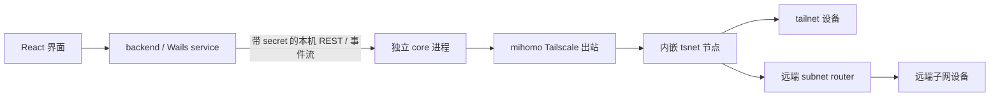

# Tailscale 接入调研

调研日期：2026-10-16。目标：从 ClashCube 访问 tailnet 内设备及远端子网。
对照官方文档与当前源码；没有操作已安装的应用、系统代理、TUN 或真实 tailnet。
本文记录实现前的调研基线；现已按此方向加入模块、管理接口和动态分流，使用说明及当前验证边界见 [tailscale.md](tailscale.md)。下文的“当前源码”和“尚未暴露”描述对应调研时的基线版本。

## 1. 建议

沿用 mihomo 已有的 Tailscale 出站，在 ClashCube 增加登录、设备/子网状态、DNS 和分流管理。
第一版围绕“连接我的内网”设计：浏览器登录，显示设备，选择要访问的远端子网，检测当前流量能否进入内核。

当前子模块已经具备数据通路，无需另接一套 WireGuard 协议实现。Tailscale 本身还需要协调服务、身份、设备发现、打洞和中继，不能用静态 WireGuard 配置替代。
官方提供的 [tsnet](https://tailscale.com/docs/features/tsnet) 可以把独立 Tailscale 节点嵌入 Go 进程；本项目依赖的 mihomo 实际使用 MetaCubeX 的 tsnet fork。

第一版先交付 TCP/UDP 出站、MagicDNS、接受远端子网和状态诊断。
Exit Node、本机服务入站、把本机发布成子网路由器、Taildrop、Tailscale SSH 服务端可以独立评估。
普通 SSH 连接到远端设备的 22 端口属于 TCP 出站，已经包含在目标内，但 SSH 客户端的流量需要经过 ClashCube。

## 2. Surge 和其他项目怎么做

| 项目 | 接入方式 | 值得借鉴的设计 |
| --- | --- | --- |
| Surge | `tailscale` 出站策略；只有被分配到它的流量进入 tailnet | 登录与设备状态放在策略内；自动识别设备，子网显式分流 |
| sing-box | 自 1.12.0 引入 Tailscale endpoint，可用于路由，也有更广的双向能力 | 把登录和运行状态作为独立能力管理 |
| mihomo | `type: tailscale` 出站，内部使用 tsnet | 可以直接复用，是当前项目改动最少的路径 |
| 官方 Tailscale | 普通客户端管理系统网络；也提供用户态 HTTP/SOCKS5 模式 | 区分“节点已联网”和“应用流量进入了节点” |

来源：[Surge 手册](https://manual.nssurge.com/policies/tailscale.html)、[sing-box 文档](https://sing-box.sagernet.org/configuration/endpoint/tailscale/)、[mihomo 文档](https://wiki.metacubex.one/config/proxies/tailscale/)、[Tailscale 用户态网络](https://tailscale.com/docs/concepts/userspace-networking)。版本号为文档标注的能力起点，未通过竞品应用实测。

Surge 的几个相关约定：

- Mac 6.7.0 / iOS 5.20.0 起支持 Tailscale；Mac 6.8.0 / iOS 5.21.0 起支持交互登录、自动分流和默认常驻会话。
- 自动分流覆盖发现的 MagicDNS 后缀和可见设备的独立 IPv4/IPv6 地址；远端子网仍需显式规则。
- 优先尝试直接 UDP，必要时使用 DERP；界面区分 direct / relay。
- 纯内网节点用 Tailscale 连通性探测，不能用公网 URL 测试结果判断其是否可用。
- 较新文档还列出了入站与路由发布能力，属于更大的功能范围。

以上描述来自 [Surge 的公开行为说明](https://manual.nssurge.com/policies/tailscale.html)，不能据此确认其内部源码或所用 SDK。

sing-box 的 `auth_key` 可省略，已有持久化身份时不再使用它；图形客户端提供 endpoint 登录管理入口。
它还支持接受/发布子网、出口节点和可选系统 TUN。ClashCube 可以参考其管理体验，当前没有切换内核的必要。[sing-box 文档](https://sing-box.sagernet.org/configuration/endpoint/tailscale/)

## 3. 当前仓库已经有什么

核对的 mihomo 子模块提交：`61beae9e8dd6e2152c33d53b217252df549a42f3`。

| 能力 | 源码证据 | 结论 |
| --- | --- | --- |
| 内嵌 Tailscale 节点 | [tailscale.go](../third_party/mihomo/adapter/outbound/tailscale.go) 的 `NewTailscale` | 已有 tsnet、TCP/UDP、持久化 state |
| 接受远端子网 | 同文件的 `AcceptRoutes` / `buildTailscaleMaskedPrefs` | 可生成 `accept-routes: true` |
| 浏览器认证基础 | `AuthKey` 可空，tsnet 的 `UserLogf` 被转发到日志 | 已有登录 URL，缺结构化登录接口及 UI |
| MagicDNS | 同文件的 `tailscaleDNSTransport` 与 [dns/tailscale.go](../third_party/mihomo/dns/tailscale.go) | 已有节点内部解析及 `ts://节点名` DNS 客户端 |
| 构建开关 | [Taskfile.yml](../Taskfile.yml)、[build-windows.ps1](../scripts/build-windows.ps1) | 两个平台均设置 `with_gvisor`，未设置 `no_tailscale` |
| 配置叠加 | [runtimecfg.go](../internal/runtimecfg/runtimecfg.go) 与 [modules.Kind](../internal/modules/kind.go) | 可以通过模块生成节点、DNS 和规则 |
| 状态、设备、登录控制 API | 当前 [proxies 路由](../third_party/mihomo/hub/route/proxies.go) 与 Tailscale 出站公开方法 | 尚未暴露专用管理接口 |

现有出站在第一次连接或 DNS 请求时启动；配置解析成功不代表已经登录。
当前 `watchBackendState` 主要用于初始化及 Exit Node 设置，并不是持续向 GUI 发布状态的观察器。
需要区分 `NeedsLogin`、`NeedsMachineAuth`、`Starting`、`Running`、错误和停止，不能仅用“节点存在”显示“已连接”。

已做离线验证：以 `go run -mod=readonly -tags with_gvisor` 运行临时探针，在 `/tmp` 隔离 home 调用当前 mihomo 的 `config.Parse`。
包含 Tailscale、UDP、`accept-routes: true`、`ts://TailnetOffice` DNS policy、fake-ip 排除及设备/子网规则的配置通过解析：

```text
parsed: type=Tailscale udp=true rules=4 dns-policies=1
node state was not created; no session was started
```

探针只解析配置并关闭适配器，没有应用配置或监听 mixed 端口。
这证明当前 macOS 构建环境中的配置能力；不证明真实登录、打洞、转发或 Windows 运行效果。

## 4. 建议的实现边界



保留 [design.md](design.md) 的边界：GUI 不调用 mihomo 单例；行为放 `backend`；协议及其生命周期修改放 mihomo fork。
Tailscale 用户态出站本身无需管理员权限；任意应用的透明接管继续使用现有 TUN 和提权流程。

### 配置与界面

建议新增一个 Tailscale 表单模块，遵循现有 `modules.Kind` 和前端 registry，先支持一个连接，避免首版引入多 tailnet 的重叠地址问题。

保存的配置包含显示名称、稳定身份 ID、节点 hostname、可选 control URL、MagicDNS 配置和用户选择的远端 CIDR。
身份 ID 用于生成稳定的 `state-dir`，不随显示名、订阅更新或重载改变；复制模块时明确选择复用连接或创建新身份，不能意外并行使用同一 state。
默认非临时节点、UDP 开启、接受子网；启用接受子网不等于把所有子网流量都分配给它。

界面首先提供“登录 Tailscale”、连接状态、本机 tailnet IP、设备列表，以及“访问这些远端子网”。
子网从运行状态发现，用户勾选后才产生 ClashCube 分流规则；自定义 control URL、Auth Key 等放高级选项。
自动展示不等于自动打开浏览器，登录应由用户操作触发。

### 内核接口

在 mihomo fork 为 Tailscale 出站暴露小范围、结构化能力：启动/认证、状态快照、状态变化通知、退出登录和对指定 peer 的连通性探测。
使用 tsnet 的 `LocalClient`、`WatchIPNBus`、`Status` 等现有能力，避免解析日志推断登录状态。
适配器有 `autoCloseProxyAdapter` 等包装层，实现时需要明确透传这项能力，不能假定 `Adapter()` 能直接断言成 `*Tailscale`。

ClashCube 在 `internal/core` 的现有受认证路由下接入这些能力，再由 `internal/mihomoapi` 和 `backend` 转成 Wails 调用/事件。
只暴露需要的字段，避免把完整 Tailscale LocalAPI、原始 netmap 或私钥数据直接提供给前端；root helper 继续保持既有四种操作。
状态事件进入 `store.ts`，不用页面轮询模拟已有的事件能力。

动态设备地址发生变化时，应在 core 内更新分流信息，或者先采用静态配置并明确其限制；不要每次收到 peer 变化就重新加载整个配置。
实现前需验证路由信息来源：当前依赖的 `ipnstate.Status` 有 `CurrentTailnet.MagicDNSSuffix`、peer 地址、`AllowedIPs`、`PrimaryRoutes` 等字段，展示和实际可路由范围需要分别处理。
不能把 `AllowedIPs` 简单等同于 ACL 授权或当前可用性。

## 5. 需要先处理的问题

### 流量可能根本没进入内核

[默认设置](../internal/settings/settings.go) 把 `10.0.0.0/8`、`172.16.0.0/12` 和 `192.168.0.0/16` 放进系统代理 bypass。
因此浏览器访问远端 `10.20.0.10`，即使 ClashCube 有正确规则，也可能绕过它。
SSH、数据库和远程桌面客户端也未必使用系统代理。

产品需要检测并说明当前接管方式：支持显式 HTTP/SOCKS 代理的应用可以直接使用 mixed 端口；需要透明接管的应用走现有 TUN 流程。
系统代理模式若要支持远端私网，必须处理有效 bypass 与所选 CIDR 的冲突，保留用户原始设置并展示实际行为。
不能用“一键连接”暗中开启系统代理或 TUN。

### 本地分流与 Tailscale 路由是两层

远端 subnet router 必须发布路由，路由经过审批，客户端接受路由，且 ACL/grants 允许目标连接。
ClashCube 还必须把目标流量分配给 Tailscale 出站；仅开启 `accept-routes` 无法替代这一步。
路由批准与访问控制是不同机制，诊断时应分别显示。[Tailscale 路由说明](https://tailscale.com/docs/reference/route-injection)

默认仅自动接管可见 peer 的 `/32`、`/128` 和本 tailnet 的 MagicDNS 后缀。
不建议硬编码接管整个 `100.64.0.0/10`，也不把整个 RFC1918 私网都送入 tailnet。
远端子网优先于通用 LAN DIRECT 规则，但与本地网段重叠时必须让用户选择目的网络。
两个地方都使用 `192.168.1.0/24` 时，单靠同一个目标 IP 无法推断意图。
已选择的远端子网在 router 离线时应保留分流并报错，避免删除规则后落到普通 LAN DIRECT。
与已有的“仅这些应用代理”模块也要定义兼容行为：该模块会替换规则，不能假定普通前插规则总能保留。

### DNS 需要和连接使用同一个 tailnet

通过 `ts://节点名` 为实际 MagicDNS 后缀设置 `nameserver-policy`，复用内核已有解析能力。
避免把所有 `*.ts.net` 发到同一个私网 DNS；有公司自定义域名时，只添加用户选定或控制面明确配置的域。
纯代理模式不能保证系统能解析短主机名，第一版优先支持完整 MagicDNS 名称。[MagicDNS 说明](https://tailscale.com/docs/features/magicdns)

fake-ip 排除要尊重现有 `fake-ip-filter-mode`：blacklist、whitelist、rule 的含义不同，不能直接往任何配置追加同一个字符串。
DNS bootstrap 也不能依赖尚未登录的 Tailscale 节点，否则会形成控制面登录与 DNS 的循环依赖。

### 身份持久化与配置重载

当前默认 `state-dir` 是 `tailscale`，多个连接若不显式隔离会共用目录。
使用固定的 `core/tailscale/<稳定身份 ID>/`，并保留身份跨重启、订阅切换和配置重载。
省略 Auth Key 允许交互登录，但“断开”“退出登录”“删除身份”需要分别定义，不能在断开时删除 state。

当前内核重载会创建新代理；旧适配器依靠 finalizer 和存量连接引用释放。
因此固定 state 路径并不自动保证会话安全交接：旧实例可能仍存活，新实例可能已经开始访问同一身份。
应先验证这条路径，必要时在 fork 中按稳定身份复用会话或实现明确的串行交接；不能依赖 GC 时机完成身份交接。

macOS 从普通 core 切到 root core 后，tsnet 的原子 state 写入可能产生 root 所有的文件，切回普通用户后可能无法读取。
这是从当前双运行模式和所依赖 tsnet `0700` 目录、`0600` 状态文件写入逻辑得出的风险，尚未实测。
在原型阶段必须确定统一的 state 所有者/读写策略，覆盖原子替换后的权限；不能靠放宽权限或给 helper 增加任意路径操作解决。
Windows 则需覆盖同一用户提权前后的文件 ACL 与会话结束后的重新启动。

### 状态、测试与故障恢复

[当前延迟测试](../internal/backend/latency.go) 对所有普通节点使用全局测试 URL。
纯内网 Tailscale 节点通常没有公网出口，不能因此标为断线，也不应意外进入通用 `include-all` 自动测速/公网出口组。
优先提供 peer 探测和用户指定的内网服务测试；需要显式管理自动组的候选节点范围，保留用户有意配置的策略。
操作系统 `ping` 也不能当作本功能的完整验收标准。

DERP 中继属于正常可用状态；直连、首次建连、休眠唤醒、换网络和中继回退都要在状态中可解释。
默认先复用直连控制面及传输路径；如后续提供前置代理，需单独验证控制面、DERP、STUN、peer UDP 和 TUN 防回环，不能照搬 Surge 的代理链限制。
Auth Key 和 state 都是凭据：避免出现在可共享模块、导出和普通日志中；浏览器登录可减少把 Auth Key 持久化进 YAML 的需要。

## 6. 最小配置原型

以下是可叠加在已有配置上的模块示意。假设原配置已启用 DNS 且 fake-ip filter 使用 blacklist 模式。
域名、peer 地址、CIDR 必须替换成实际值；不含真实凭据，也不会主动发起登录。

```yaml
append-proxies:
  - name: TailnetOffice
    type: tailscale
    hostname: clashcube-office
    state-dir: tailscale/office-example
    ephemeral: false
    udp: true
    accept-routes: true

dns:
  nameserver-policy:
    "+.example-tailnet.ts.net":
      - ts://TailnetOffice
  +fake-ip-filter:
    - "+.example-tailnet.ts.net"

prepend-rules:
  - DOMAIN-SUFFIX,example-tailnet.ts.net,TailnetOffice
  - IP-CIDR,100.101.102.103/32,TailnetOffice,no-resolve
  - IP-CIDR,10.20.0.0/24,TailnetOffice,no-resolve
```

该原型第一次请求才会触发启动，没有保存身份时从日志获得登录 URL。
它用于证明已有数据通路，不能代替正式登录与状态界面，也没有解决 bypass、规则覆盖或重载交接问题。
不应以此原型宣称完整功能已交付。

## 7. 实施顺序与验收

1. **先验证数据通路和身份生命周期。** 隔离 home、独立 mixed 端口，从一个测试 tailnet 验证设备 TCP/UDP、MagicDNS 和一个远端子网；随后反复 reload、重启、切订阅、切用户/提权模式，确认身份不重复、不丢失且 state 可读。
2. **再实现可用的产品入口。** fork 暴露有限管理能力，接入认证 REST/事件；实现浏览器登录、设备列表、子网选择、结构化错误及接管诊断；表单模块按既有 Kind 机制生成配置，更新翻译和 Wails bindings。
3. **最后加入动态分流与恢复。** 自动更新 peer 地址和 MagicDNS 后缀，处理与本地网络及其他模块的冲突，覆盖网络变化、休眠和 DERP 回退；不为设备状态变化反复重载内核。

上线前至少覆盖：

- 无 Auth Key 登录、需要管理员批准、节点身份失效；失败后能明确重试。
- peer IP、完整 MagicDNS 名称、远端子网 IP 的真实连接；禁止访问时显示失败。
- 未获批准的路由、ACL 拒绝、离线 peer 不回退到普通 DIRECT；仅凭超时不能断言是 ACL 拒绝。
- 默认私网 bypass、显式代理、TUN、LAN DIRECT、应用分流模块、重叠子网。
- 重载期间存量连接、新连接与 state 访问；普通/提权模式转换及进程退出后重启。
- UDP 受限时的 DERP 回退、网络切换和休眠唤醒。
- macOS 与 Windows 实机；单独验证 IPv6，不能仅因存在配置字段就声明支持完成。

实现后运行相关模块/内核回归测试、`go test ./internal/...`、`go test -tags with_gvisor ./internal/...`、前端类型检查与测试、绑定生成及目标平台构建。
Tailscale 实现受 build tag 控制，只有默认 Go 测试无法覆盖真实适配器；fork 的相关测试也必须带 `with_gvisor`。
调研阶段完成公开资料、源码核对和 macOS 离线解析验证。后续实现及自动化验证见 [tailscale.md](tailscale.md)；上述真实网络、系统集成及 Windows 实机验收尚未执行。
